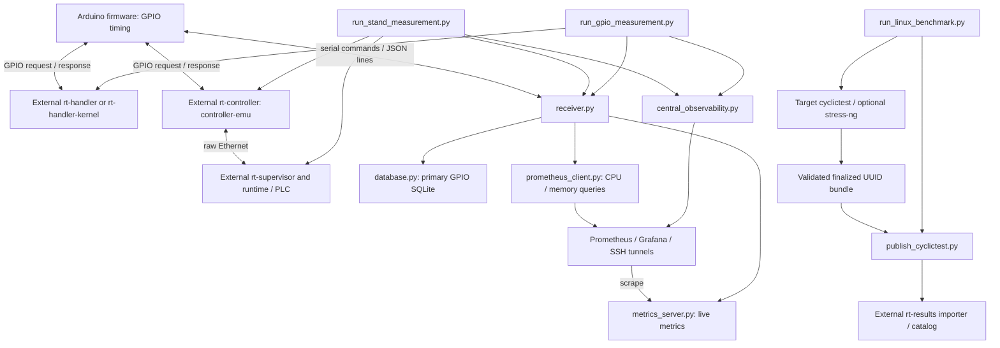

# Architecture

[Русский](../ru/development/architecture.md)

This is a map of the current implementation, including its limitations. For
measurement meaning, see [measurement statistics](../reference/measurement-statistics.md);
for evidence and unexecuted checks, see [validation](../reference/validation.md).

## Three measurement modes

Text fallback: standalone GPIO = Arduino → handler → Arduino → receiver →
SQLite; supervised = Arduino → controller → Ethernet → supervisor/runtime →
controller → Arduino → receiver → SQLite; cyclictest = target scheduler benchmark
→ finalized bundle → optional catalog import. GPIO timing and cyclictest scheduler
wakeup latency are different quantities; they are not interchangeable baselines.

External repository boundaries are `rt-handler` (userspace responder),
`rt-handler-kernel` (`rt_gpio_responder` module), `rt-controller` (controller bridge),
`rt-supervisor` (supervisor and example runtime), and `rt-results` (cyclictest
import/catalog). A production PLC/runtime is supplied separately. See
[target GPIO software](../hardware/target-gpio.md),
[supervised mode](../modes/supervised-raw-ethernet.md), and
[publication](../usage/publish-cyclictest.md). These are not built as part of the
PC Python tools.

## Active source modules and artifacts

| Area | Current responsibility |
|---|---|
| `scripts/run_gpio_measurement.py` | Standalone preflight, backend selection, target lifecycle, tuning, receiver launch, integrity checks |
| `scripts/run_stand_measurement.py` | Multi-board startup/arming, receiver gate, network diagnostics, trace import and consistency checks |
| `scripts/central_observability.py` | Shared central observability configuration and SSH tunnel lifecycle; runners also prepare local services |
| `scripts/run_linux_benchmark.py`, `publish_cyclictest.py` | Native cyclictest JSON validation, bundle finalization, validated publication and retry state |
| `src/arduino-meter/arduino-meter.ino`, `measurement.cpp` | Serial command handling, pending-request/timeout accounting, interrupt timing, group statistics and retained tail |
| `src/pc-receiver/receiver.py` | Collector state and threads; coordinates serial, storage, metrics and session logging |
| `config.py`, `config_loader.py`, `serial_comm.py`, `arduino_monitor.py`, `logging_utils.py` | Defaults/state paths, receiver parameter parsing, serial JSON lines, no-data fall/recovery detection, session logs |
| `database.py`, `metrics_server.py`, `prometheus_client.py` | SQLite transactions/schema, standard-library HTTP exposition, synchronous Prometheus API requests |
| `import_trace_metrics.py`, `trace_summary.py` | Import supervised stage aggregates into `trace_group_metrics`; summarize stored trace data |
| `plot_statistics.py`, `merge_databases.py` | Source-only offline reports and historical database aggregation |

`soc_monitor.py` is a historical SSH/Paramiko monitoring path, not imported by the
current receiver. `promql_metrics.py` is a historical PromQL/pandas analysis helper,
not the current SQLite plotting path. Older client methods need not match the
metrics emitted today. The `src/socs-investigation/` directory is empty in this
checkout; do not infer an active monitor/build target from its name.

The RPM specification `.gear/rt-tester-tools.spec` installs runners, collector
support, trace tools, profiles and observability assets. Wrappers use
`/usr/share/rt-tester-tools` (overridable via `RT_TESTER_ROOT`). Plotting, merging,
historical helpers, tests, Arduino firmware and target software are outside that
installed executable scope. Documentation is packaged separately as `%doc`.

## Collector lifecycle and serial boundary

Construction initializes SQLite and starts the metrics HTTP server on all
interfaces at port 9101. Connecting opens serial at the default 115200 baud,
waits for reset, clears input and sends `STOP`. `run()` starts a serial-reader
thread and a fall/auto-stop monitor thread; commands run in the main thread.

`_cmd_start()` sets the session ID, timestamps, collecting flag, counters and fall
monitor state **before** sending `START {JSON}`. It also updates the metrics
session and writes a start event. Parameters are `session_id`, `groups`,
`worst_count`, `interval_us`, `measurements_per_group`, `response_timeout_us`;
`groups = 0` means unlimited. The receiver derives the retained count as
`max(1, int(measurements_per_group * 0.05))`. Firmware applies its own bounds and
echoes the applied parameters in `started`; mismatches produce warnings.

Firmware accepts newline-terminated `START`, `STOP`, `STATUS`, `RESET` and emits
JSON lines. Receiver interactive `status` shows local state, rather than sending
firmware `STATUS`. Groups contain request/response/timeout counters and the worst
latencies. A timeout is a lost response, not a latency sample. Group indexes start
at zero. See [Arduino](../hardware/arduino.md) for the hardware protocol.

Matching `stopped`/`auto_stopped` statuses end collection; stale start/stop statuses
are ignored. A group with a different session ID instead changes the local session
and logger, even before the collecting check. Manual stop and collector auto-stop
clear the collecting flag immediately; stop-event persistence therefore differs
from a matching Arduino stop received while collecting. This is flag-based state,
not a single transactional state machine. Any parsed serial message refreshes the
fall monitor; a fall means missing serial data, not proof of target failure.

For supervised startup, `--start --start-gate-stdin` connects and prints the exact,
flushed line `Arduino ready for target start`. The runner detects it, executes its
target-start callback, then writes `start\n` to stdin. Any input line releases the
gate; EOF fails. The runner also parses `Group N/M stored (index ..., ...%)` for
progress. This stdout is an effective machine interface; translating or rewording
it requires corresponding runner/tests changes. The gate is not the Arduino's
`started` acknowledgement.

## Persistence and current coupling

GPIO's primary artifact is SQLite: groups, retained latencies, events, optional
SoC metrics and supervised trace aggregates. Whole-group mean and other serial
summary fields are not all stored in the schema. Live Prometheus gauges/logs are
secondary; remote write does not transfer the SQLite artifact.

For each collecting group the receiver enriches the message, adds it to metrics
storage, queries CPU/memory synchronously, appends JSON to the metrics log, then
saves the group transaction. Two Prometheus queries may each wait up to the
client's 30-second timeout; errors are swallowed by the helper. Thus disabled or
unavailable observability does not remove this collection-path coupling. Current
node queries have no target-instance filter, so multi-target results need care.

`MetricsStorage.add_group()` overwrites the supplied dictionary's `session_id`
with a string and retains the same dictionary reference. Later enrichment is
visible to HTTP readers; its lock does not make collector mutations atomic.
`database.get_db_manager()` caches one global manager: the **first path wins**,
even when later calls supply another path. Tests reset private `_db_manager` to
isolate temporary databases; that is a test workaround, not multi-database support.

`merge_databases.py` scans `results_*/*.db`, remaps group IDs and handles a subset
of historical tables. It does **not** copy `trace_group_metrics`; merged output
loses trace evidence. Session collisions and table-specific ID conflicts also
make it unsuitable as a lossless archival format. Preserve original databases.

Cyclictest's primary artifact is a UUID directory containing native JSON,
logs and `manifest.json` with metadata, validation summary and artifact hashes.
The runner validates in `.UUID.partial` and renames only a completed bundle.
Publication validates the bundle and imports it over SSH into the external
catalog; retry sidecars and the catalog are secondary to the finalized bundle.

Next: [development and testing](development-and-testing.md) ·
[change guide](change-guide.md).
