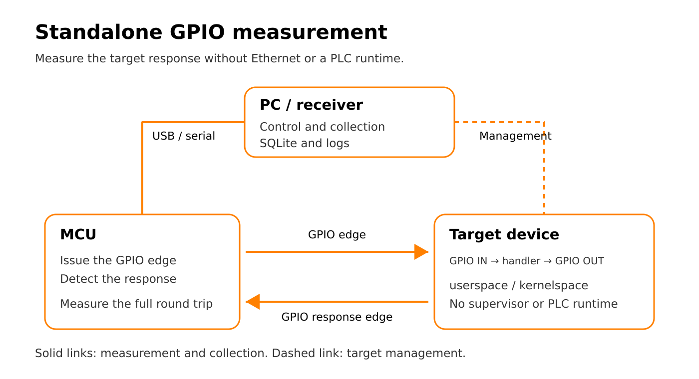

# Standalone GPIO

[Русский](../ru/modes/standalone-gpio.md)

## Measurement principle



The microcontroller (MCU) issues a GPIO edge and measures the time until it
detects the target's response edge. The target handler reads the input and sets
the output; it may run in userspace or kernelspace. There is no Ethernet message,
supervisor, or PLC runtime in this measurement path.

The PC controls collection over USB serial and stores group results in SQLite.
Its management connection to the target is separate from the timed GPIO path.
The drawing is hardware-neutral; the supplied firmware uses an Arduino MCU.
Electrical level adaptation and a suitable ground connection are not drawn:
follow the [wiring requirements](../hardware/target-gpio.md) for the actual hardware.
This is a physical round-trip measurement, not an isolated IRQ or handler CPU-time
measurement. See [measurement statistics](../reference/measurement-statistics.md).

## Adapting a project profile

Historical comparison profiles describe a particular laboratory environment,
not automatic hardware discovery. Check the SSH host, exact expected kernel,
selected handler binary, output paths and monitoring mode before running.
`expected-kernel` intentionally rejects a different boot kernel; update the
kernel label as well when explicitly preparing a new experiment.

Userspace comparison profiles select `/root/rt-handler-userspace/src/rt-handler`.
That source-build binary must exist on the target. To use the installed package,
select `/usr/sbin/rt-handler` instead. Building a source tree does not automatically
change the configured `binary`.

Standalone profiles now derive node_exporter's endpoint from the SSH host on port
9100. Set `node-exporter-target` explicitly only for a different exporter address.
Central profiles also require their server/key/forwarding settings. For plain
collection use both disabling flags; for local monitoring use the local template.
See [local](../observability/local.md) and [central](../observability/central.md).

This mode measures the Arduino → target GPIO → handler → Arduino round trip.
It excludes supervisor, raw Ethernet, and Beremiz/runtime layers. For a complete
first experiment, use the [VisionFive 2 walkthrough](../usage/standalone-gpio-walkthrough.md).

```text
PC receiver ──serial── Arduino D7 → level adaptation → target input
                      Arduino D20 ← level adaptation ← target output ← handler
```

The normal execution path uses installed userspace `rt-handler`. Kernelspace
profiles use `rt_gpio_responder`. Their implementations belong to the external
target repositories, not to `rt-tester`.

## Profiles and execution

Use a reader-owned copy of one of the neutral installed examples:

```text
/usr/share/rt-tester-tools/configs/stands/examples/visionfive2-gpio-basic.conf
/usr/share/rt-tester-tools/configs/stands/examples/visionfive2-gpio-local.conf
/usr/share/rt-tester-tools/configs/stands/examples/visionfive2-gpio-central.conf
```

Edit `host = root@TARGET_HOST`, metadata, and output paths; check Arduino serial
discovery and access separately.
`board = starfive` selects the VisionFive 2 runtime board profile in `rt-handler`;
the reader-facing board label remains `visionfive2`. Typical installed target
fields are:

```ini
[target]
host = root@TARGET_HOST
label = visionfive2
board = starfive
binary = /usr/sbin/rt-handler
args = -b {board}
workdir = /
metrics-log = /dev/null
housekeeping-cpus = 0
```

From the saved experiment directory, after preparing the stand and converting
the template's PC paths to absolute paths as shown in the
[walkthrough](../usage/standalone-gpio-walkthrough.md):

```bash
rt-tester-run-gpio --config ./visionfive2-gpio-basic.conf \
  --groups 3 --no-prometheus --no-grafana
```

Both disabling flags are required for basic collection. Installed `0.4.2` resolves
an unadapted relative database path in the receiver directory; the updated source
runner normalizes it against the launch directory. Absolute paths work with both.
Use [local](../observability/local.md) or
[central observability](../observability/central.md) for live monitoring.
The neutral local ports are receiver `9101`, Prometheus `9092`, and Grafana `3002`.
Older stand profiles describe specific laboratory deployments; inspect them
before use rather than assuming their addresses and paths are portable.

## Runner lifecycle

The runner checks SSH, target tools, and Arduino serial access; optionally sets
the target clock; cleans up old handler/stress processes; prepares observability;
starts the selected handler; applies scheduling and affinity; starts receiver
collection; then prints diagnostics and a SQLite summary. Stress is controlled
by the profile. Handler/stress cleanup runs afterward unless `--keep-target` is
set. `--prepare-only` prepares the target without Arduino collection
and still changes target state.

`--dry-run` prints many planned commands but can write generated configuration
and probe local state. It is not a side-effect-free check. Use `--help` for CLI
inspection.

The target **must have a running `node_exporter` even with both observability
flags disabled**. The runner checks for it and unconditionally pins its threads
to `SCHED_OTHER` on `housekeeping-cpus`, so it does not compete with the real-time
GPIO handler. The legacy handler text metrics log is not imported; profiles
normally direct it to `/dev/null`. CPU/memory collection uses Prometheus instead.
The disabling flags suppress managed monitoring startup; they do not disable the
receiver's query client. Check for an unrelated Prometheus already listening at
the configured URL before treating the run as a clean no-monitoring condition.

## Source and kernel variants

For userspace development, `--deploy` copies the configured `rt-handler-local`
tree to target `repo`; `--build` runs `make` in `<repo>/src` without copying.
Combining them deploys then builds. A build-only run requires an existing remote
source tree. Set `binary` and `workdir` to that tree in your own profile; installed
package profiles do not require compilation. See the
[developer route](../development/development-and-testing.md).

Kernel profiles specify:

```ini
[target]
execution-mode = kernelspace
module = rt_gpio_responder
```

The runner checks/loads the module and checks IRQ state. It rejects `--deploy`
and `--build` in this mode. The module must match the running kernel, and only
one handler may own the GPIO lines. See [target GPIO](../hardware/target-gpio.md).

## Wiring and artifacts

Arduino Mega D7 sends the request; D20 receives the response. A common ground
and suitable electrical level adaptation are required. GPIO chip/line mappings
come from `/etc/rt-handler/boards.d/*.conf` and the external handler's built-in
profiles; line numbers are not physical header pin numbers.

SQLite stores groups, retained worst-tail latencies, events, and optional
`soc_metrics`. Prometheus does not replace or upload the database. Receiver logs
and `metrics_all_groups.log` use XDG state or `RT_TESTER_STATE_DIR`; profile paths
control database and observability artifacts independently. See
[runtime paths](../reference/runtime-paths.md), [statistics](../reference/measurement-statistics.md),
and [analysis](../usage/analysis-and-reports.md).

Managed observability can remain available after collection. Stop it using the
same profile and launch directory:

```bash
rt-tester-run-gpio --config ./visionfive2-gpio-local.conf --stop-observability
```

The standalone dashboard UID is `rt-standalone-gpio`; it shows tail latency,
whole-group jitter, and target load for the selected board/session. A dated
[baseline report](../results/standalone-gpio-baseline.md) illustrates earlier runs.
