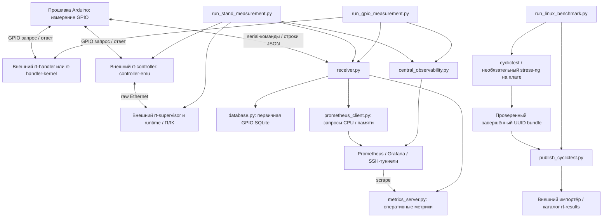

# Архитектура

[English](../../development/architecture.md)

Это карта текущей реализации с её ограничениями. Смысл показателей описан в
[статистике измерений](../reference/measurement-statistics.md), выполненные и
ожидающие проверки — в [записи валидации](../reference/validation.md).
GPIO (General-Purpose Input/Output) — цифровые линии ввода/вывода общего
назначения. Latency (задержка) здесь означает время от запроса до ответа;
у cyclictest это задержка пробуждения потока планировщиком. PREEMPT_RT — набор
механизмов ядра Linux для повышения вытесняемости и предсказуемости задержек;
он не делает разные методы измерения эквивалентными.

## Три режима измерения

Текстовая схема: standalone GPIO = Arduino → обработчик → Arduino → receiver →
SQLite; supervised = Arduino → контроллер → Ethernet → supervisor/runtime →
контроллер → Arduino → receiver → SQLite; cyclictest = тест планировщика на плате
→ завершённый bundle → необязательный импорт в каталог. Задержки GPIO и пробуждения
cyclictest — разные величины; использовать их как взаимозаменяемую базу нельзя.

Границы внешних репозиториев: `rt-handler` (userspace-обработчик),
`rt-handler-kernel` (модуль `rt_gpio_responder`), `rt-controller` (мост контроллера),
`rt-supervisor` (supervisor и пример runtime), `rt-results` (импорт/каталог
cyclictest). Рабочий ПЛК/runtime поставляется отдельно. См.
[ПО GPIO на плате](../hardware/target-gpio.md),
[supervised-режим](../modes/supervised-raw-ethernet.md) и
[публикацию](../usage/publish-cyclictest.md). Они не собираются вместе с Python-
инструментами управляющего ПК.

## Активные модули и артефакты

| Область | Текущая ответственность |
|---|---|
| `scripts/run_gpio_measurement.py` | Предварительные проверки standalone, выбор backend, жизненный цикл платы, настройка приоритетов, запуск receiver, проверка целостности |
| `scripts/run_stand_measurement.py` | Запуск/активация нескольких плат, стартовый шлюз receiver, диагностика сети, импорт и проверка согласованности trace |
| `scripts/central_observability.py` | Общая конфигурация центрального наблюдения и SSH-туннелей; runner также готовит локальные сервисы |
| `scripts/run_linux_benchmark.py`, `publish_cyclictest.py` | Проверка native JSON cyclictest, завершение bundle, проверенная публикация и состояние повторной отправки |
| `src/arduino-meter/arduino-meter.ino`, `measurement.cpp` | Serial-команды, учёт ожидающего запроса/тайм-аутов, измерение в прерывании, статистика группы и сохранённый хвост |
| `src/pc-receiver/receiver.py` | Состояние и потоки сборщика; координация serial, БД, метрик и журналов сессии |
| `config.py`, `config_loader.py`, `serial_comm.py`, `arduino_monitor.py`, `logging_utils.py` | Значения по умолчанию/пути состояния, параметры receiver, serial JSON, обнаружение отсутствия данных и восстановления, журналы |
| `database.py`, `metrics_server.py`, `prometheus_client.py` | Схема/транзакции SQLite, HTTP-метрики средствами стандартной библиотеки, синхронные запросы API Prometheus |
| `import_trace_metrics.py`, `trace_summary.py` | Импорт агрегатов этапов supervised в `trace_group_metrics`; сводка сохранённого trace |
| `plot_statistics.py`, `merge_databases.py` | Офлайн-отчёты и объединение исторических БД, только из исходников |

`soc_monitor.py` — исторический путь мониторинга через SSH/Paramiko; текущий
receiver его не импортирует. `promql_metrics.py` — исторический помощник анализа
PromQL/pandas, не текущий путь построения графиков из SQLite. Старые методы
клиента могут не соответствовать сегодняшним метрикам. `src/socs-investigation/`
в этом checkout пуст: имя каталога не доказывает наличие активного монитора или
цели сборки.

RPM-спецификация `.gear/rt-tester-tools.spec` устанавливает runner, поддержку
сборщика, trace-инструменты, профили и материалы наблюдения. Обёртки используют
`/usr/share/rt-tester-tools` (переопределяется через `RT_TESTER_ROOT`). Графики,
объединение БД, исторические помощники, тесты, прошивка Arduino и ПО плат не входят
в этот набор установленных исполняемых инструментов. Документация упаковывается
отдельно как `%doc`.

## Жизненный цикл сборщика и serial-граница

Конструктор инициализирует SQLite и запускает HTTP-сервер метрик на всех
интерфейсах, порт 9101. Подключение открывает serial (по умолчанию 115200 бод),
ждёт сброса Arduino, очищает вход и отправляет `STOP`. `run()` запускает поток
чтения serial и поток контроля отсутствия данных/автоостановки; команды выполняются
в основном потоке.

`_cmd_start()` устанавливает ID сессии, время, флаг сбора, счётчики и состояние
монитора **до** отправки `START {JSON}`. Он также обновляет сессию метрик и пишет
событие start. Параметры: `session_id`, `groups`, `worst_count`, `interval_us`,
`measurements_per_group`, `response_timeout_us`; `groups = 0` означает сбор без
лимита. Размер сохраняемого хвоста receiver вычисляет как
`max(1, int(measurements_per_group * 0.05))`. Прошивка применяет собственные границы
и возвращает принятые параметры в `started`; несовпадения вызывают предупреждения.

Прошивка принимает завершённые переводом строки `START`, `STOP`, `STATUS`, `RESET`
и выдаёт строки JSON. Интерактивный `status` receiver показывает локальное
состояние, а не отправляет прошивке `STATUS`. Группы содержат счётчики запросов,
ответов, тайм-аутов и худшие задержки. Тайм-аут — потерянный ответ, не отсчёт
задержки. Индекс группы начинается с нуля. Аппаратный протокол см. в
[Arduino](../hardware/arduino.md).

Совпадающие `stopped`/`auto_stopped` завершают сбор; устаревшие статусы старта и
остановки игнорируются. Группа с другим ID сессии, напротив, меняет локальную
сессию и журнал ещё до проверки флага сбора. Ручная остановка и автоостановка
сборщика сразу снимают флаг; сохранение события stop поэтому отличается от
обработки совпадающего статуса Arduino во время сбора. Состояние управляется
флагами, а не единой транзакционной машиной состояний. Любое разобранное serial-
сообщение обновляет монитор; fall означает отсутствие serial-данных, а не
доказанный отказ платы.

При supervised-запуске `--start --start-gate-stdin` подключается и выводит точную
строку `Arduino ready for target start` с немедленным flush. Runner распознаёт её,
выполняет callback запуска плат и пишет в stdin `start\n`. Любая входная строка
открывает шлюз; EOF приводит к ошибке. Для прогресса runner разбирает
`Group N/M stored (index ..., ...%)`. Этот stdout фактически является машинным
интерфейсом: перевод или изменение текста требует обновления runner и тестов.
Шлюз не является подтверждением `started` от Arduino.

## Сохранение и текущие связи

Первичный артефакт GPIO — SQLite: группы, сохранённые задержки, события,
необязательные метрики SoC и агрегаты trace supervised. Не все serial-поля,
например среднее всей группы, сохраняются в схеме. Оперативные gauges Prometheus
и журналы вторичны; remote write не передаёт SQLite-артефакт.

Для каждой собираемой группы receiver дополняет сообщение, передаёт его в
хранилище метрик, синхронно запрашивает CPU/память, дописывает JSON в журнал метрик
и лишь затем сохраняет группу транзакцией. Два запроса Prometheus могут каждый
ждать до 30 секунд; помощник подавляет ошибки. Отключённое или недоступное
наблюдение поэтому не устраняет эту связь с путём сбора. Текущие node-запросы
не фильтруются по экземпляру платы: результаты для нескольких плат требуют
внимания.

`MetricsStorage.add_group()` заменяет `session_id` переданного словаря строкой и
хранит тот же объект. Поздние дополнения видны HTTP-читателям; блокировка
хранилища не делает изменения сборщика атомарными. `database.get_db_manager()`
кэширует единственный глобальный manager: **первый путь побеждает**, даже если
следующие вызовы передают другой. Тесты сбрасывают приватный `_db_manager` для
изоляции временных БД; это тестовый обход ограничения, не поддержка нескольких БД.

`merge_databases.py` сканирует `results_*/*.db`, переназначает ID групп и работает
с частью исторических таблиц. Он **не** копирует `trace_group_metrics`: объединённая
БД теряет trace-свидетельства. Коллизии сессий и ID отдельных таблиц также не
позволяют считать его форматом архива без потерь. Сохраняйте исходные БД.

Первичный артефакт cyclictest — UUID-каталог с native JSON, журналами и
`manifest.json`: метаданные, сводка проверки и хеши файлов. Runner проверяет данные
в `.UUID.partial` и переименовывает только завершённый bundle. Публикация проверяет
bundle и импортирует его через SSH во внешний каталог; sidecar-файлы повторной
отправки и каталог вторичны относительно завершённого bundle.

Далее: [разработка и тестирование](development-and-testing.md) ·
[руководство по изменениям](change-guide.md).
