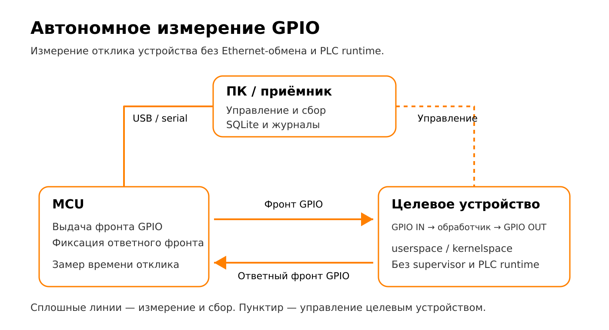

# Автономный GPIO

[English](../../modes/standalone-gpio.md)

## Принцип измерения



Микроконтроллер (MCU) выдаёт фронт GPIO и измеряет время до обнаружения ответного
фронта целевого устройства. Обработчик читает вход и устанавливает выход; он может
работать в userspace или kernelspace. В этом измерительном контуре нет
Ethernet-посылки, supervisor и PLC runtime.

ПК управляет сбором по USB serial и сохраняет результаты групп в SQLite.
Соединение управления целевым устройством отделено от измеряемого GPIO-пути.
Схема не привязана к оборудованию; поставляемая прошивка использует Arduino MCU.
Согласование электрических уровней и подходящее соединение земли не показаны:
соблюдайте [требования к проводке](../hardware/target-gpio.md) для выбранного оборудования.
Это физическое измерение полного цикла, а не отдельной задержки IRQ или CPU-времени
обработчика. См. [статистику измерений](../reference/measurement-statistics.md).

## Адаптация профиля проекта

Исторические профили сравнения описывают конкретную лабораторную среду,
а не автоматическое обнаружение оборудования. До запуска проверьте SSH-host,
точное ожидаемое ядро, выбранный исполняемый файл, выходные пути и режим мониторинга.
`expected-kernel` намеренно отклоняет другое загруженное ядро; при явной подготовке
нового эксперимента обновляйте также метку ядра в данных.

Профили сравнения userspace выбирают `/root/rt-handler-userspace/src/rt-handler`.
Этот бинарник сборки из исходников должен существовать на плате. Для пакетного
варианта выберите `/usr/sbin/rt-handler`. Сборка дерева исходников не меняет
автоматически настроенное поле `binary`.

Standalone-профили теперь выводят адрес node_exporter из SSH-host с портом 9100.
Задавайте `node-exporter-target` явно только для другого адреса exporter.
Центральные профили также требуют настройки сервера, ключа и перенаправлений.
Для обычного сбора используйте оба флага отключения; для локального мониторинга —
локальный шаблон. См. [локальный](../observability/local.md) и
[центральный](../observability/central.md) сценарии.

Этот режим измеряет полный цикл Arduino → GPIO целевой платы → обработчик → Arduino.
GPIO — линии ввода-вывода общего назначения; задержка (latency) — время от запроса
до ответа. В измерение не входят супервизор, raw Ethernet и слои Beremiz/среды
исполнения. Для первого полного эксперимента используйте
[руководство для VisionFive 2](../usage/standalone-gpio-walkthrough.md).

```text
Приёмник на ПК ──последовательный порт── Arduino D7 → согласование уровней → вход целевой платы
                                       Arduino D20 ← согласование уровней ← выход целевой платы ← обработчик
```

Обычный запуск использует установленный `rt-handler` в пространстве пользователя.
Профили пространства ядра используют `rt_gpio_responder`. Их реализации находятся
во внешних репозиториях целевого ПО, а не в `rt-tester`.

## Профили и запуск

Используйте собственную копию одного из нейтральных установленных примеров:

```text
/usr/share/rt-tester-tools/configs/stands/examples/visionfive2-gpio-basic.conf
/usr/share/rt-tester-tools/configs/stands/examples/visionfive2-gpio-local.conf
/usr/share/rt-tester-tools/configs/stands/examples/visionfive2-gpio-central.conf
```

Измените `host = root@TARGET_HOST`, метаданные и выходные пути; отдельно проверьте
обнаружение последовательного порта Arduino и доступ к нему.
`board = starfive` выбирает профиль платы VisionFive 2 в `rt-handler`;
метка платы для пользователя остаётся `visionfive2`. Типичные поля для
установленного целевого ПО:

```ini
[target]
host = root@TARGET_HOST
label = visionfive2
board = starfive
binary = /usr/sbin/rt-handler
args = -b {board}
workdir = /
metrics-log = /dev/null
housekeeping-cpus = 0
```

Из каталога сохранённого эксперимента, после подготовки стенда и преобразования
путей на ПК в абсолютные по [пошаговой инструкции](../usage/standalone-gpio-walkthrough.md):

```bash
rt-tester-run-gpio --config ./visionfive2-gpio-basic.conf \
  --groups 3 --no-prometheus --no-grafana
```

Для базового сбора обязательны оба флага отключения. В установленном `0.4.2`
неадаптированный относительный путь базы разрешается в каталоге приёмника;
обновлённый сценарий из исходников нормализует его относительно каталога запуска.
Абсолютные пути работают с обоими вариантами.
Для оперативного мониторинга используйте [локальный](../observability/local.md) или
[централизованный мониторинг](../observability/central.md). Нейтральные локальные
порты: приёмник `9101`, Prometheus `9092`, Grafana `3002`. Старые профили стендов
описывают конкретные лабораторные установки; перед использованием изучите их,
не предполагая переносимость адресов и путей.

## Жизненный цикл сценария

Сценарий проверяет SSH, инструменты целевой платы и доступ к порту Arduino;
при необходимости устанавливает время на плате; очищает старые процессы обработчика
и нагрузки; подготавливает мониторинг; запускает выбранный обработчик; применяет
политику планирования и привязку к CPU; запускает сбор приёмником; затем выводит
диагностику и сводку SQLite. Нагрузка управляется профилем. После завершения
обработчик и нагрузка очищаются, если не задан `--keep-target`. `--prepare-only`
подготавливает целевую плату без сбора Arduino и всё равно изменяет её состояние.

`--dry-run` выводит многие запланированные команды, но может записывать
сгенерированную конфигурацию и проверять локальное состояние. Это не проверка без
побочных эффектов. Для изучения командной строки используйте `--help`.

На целевой плате **обязательно должен работать `node_exporter` даже при обоих
отключённых флагах мониторинга**. Сценарий проверяет его и безусловно переводит
его потоки в `SCHED_OTHER` на `housekeeping-cpus`, чтобы они не конкурировали
с обработчиком GPIO реального времени. Старый текстовый журнал метрик обработчика
не импортируется; профили обычно направляют его в `/dev/null`. Данные CPU и памяти
собираются через Prometheus. Флаги отключения подавляют запуск управляемого
мониторинга, но не отключают клиент запросов приёмника. Прежде чем считать запуск
условием без мониторинга, проверьте, не работает ли посторонний Prometheus по
настроенному URL.

## Варианты с исходным кодом и пространством ядра

Для разработки в пространстве пользователя `--deploy` копирует настроенное дерево
`rt-handler-local` в `repo` целевой платы; `--build` запускает `make` в `<repo>/src`
без копирования. Их сочетание сначала развёртывает исходники, затем собирает.
Для запуска только сборки необходимо существующее удалённое дерево исходников.
В собственном профиле задайте `binary` и `workdir` для этого дерева; профили
установленных пакетов не требуют компиляции. См.
[маршрут разработчика](../development/development-and-testing.md).

Профили ядра задают:

```ini
[target]
execution-mode = kernelspace
module = rt_gpio_responder
```

Сценарий проверяет/загружает модуль и проверяет состояние IRQ. В этом режиме
`--deploy` и `--build` отклоняются. Модуль должен соответствовать работающему ядру,
и линиями GPIO может владеть только один обработчик. См.
[GPIO целевой платы](../hardware/target-gpio.md).

## Подключение и артефакты

Arduino Mega D7 отправляет запрос; D20 принимает ответ. Необходимы общая земля
и подходящее согласование электрических уровней. Соответствия устройств и линий
GPIO определяются `/etc/rt-handler/boards.d/*.conf` и встроенными профилями внешнего
обработчика; номера линий не являются номерами физических контактов разъёма.

SQLite хранит группы, сохранённые задержки хвоста наихудших откликов, события
и необязательные `soc_metrics`. Prometheus не заменяет и не загружает базу данных.
Журналы приёмника и `metrics_all_groups.log` используют каталог состояния XDG или
`RT_TESTER_STATE_DIR`; пути профиля независимо управляют артефактами базы и
мониторинга. См. [пути при выполнении](../reference/runtime-paths.md),
[статистику](../reference/measurement-statistics.md) и
[анализ](../usage/analysis-and-reports.md).

Управляемый мониторинг может оставаться доступным после сбора. Остановите его
с тем же профилем и из того же каталога запуска:

```bash
rt-tester-run-gpio --config ./visionfive2-gpio-local.conf --stop-observability
```

UID автономной панели — `rt-standalone-gpio`; она показывает задержки хвоста,
джиттер всей группы и нагрузку целевой платы для выбранных платы/сеанса.
[Базовый отчёт с датой](../results/standalone-gpio-baseline.md) иллюстрирует прежние запуски.
