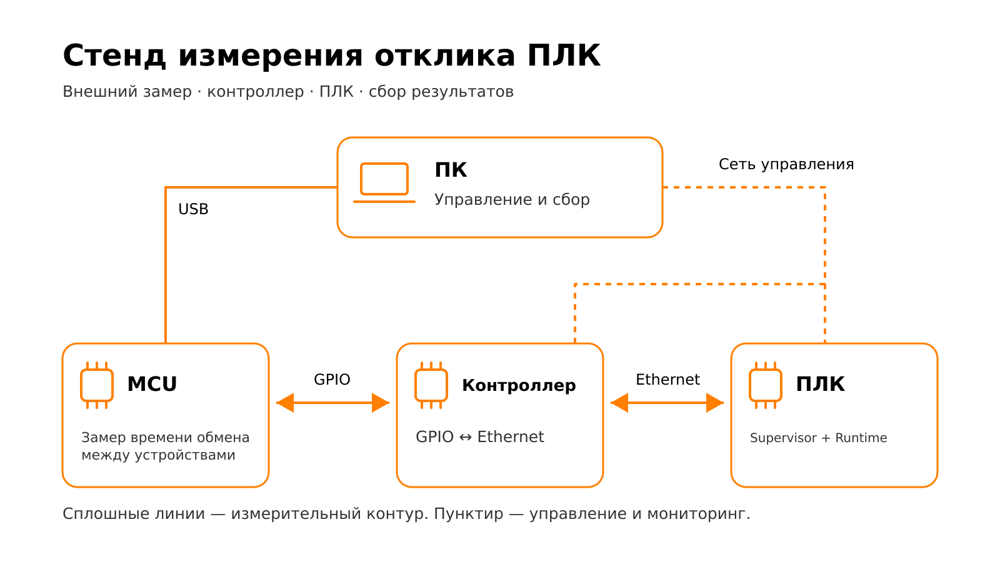
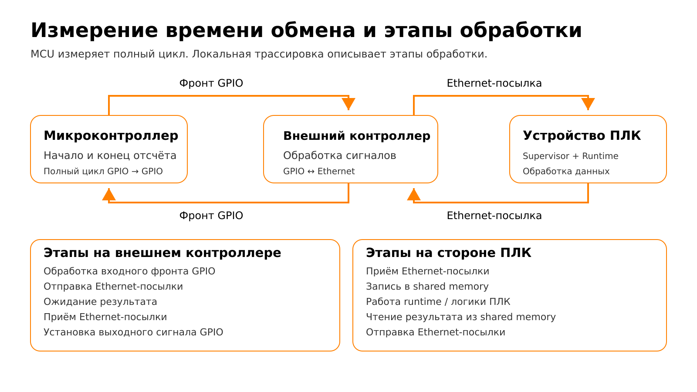

# Raw Ethernet с супервизором

[English](../../modes/supervised-raw-ethernet.md)

Этот режим измеряет задержку (latency) полного цикла через Arduino, контроллер,
raw Ethernet, супервизор и среду исполнения. `rt-tester-run-stand` управляет
барьером готовности, нагрузкой, приёмником и сбором трассировки. GPIO — линии
ввода-вывода общего назначения.

## Устройство стенда и принцип обмена



Микроконтроллер (MCU) измеряет полный цикл GPIO. Внешний контроллер преобразует
события GPIO в raw Ethernet-посылки. На устройстве ПЛК супервизор обменивается
данными с runtime через shared memory; результат возвращается через Ethernet
и выход GPIO контроллера. ПК управляет сбором и сохраняет результаты, но не
пересылает измеряемые Ethernet-посылки между устройствами.
Названия устройств обозначают роли, а не обязательные модели оборудования
или конкретную реализацию runtime. Поставляемая прошивка MCU использует Arduino.



Списки этапов описывают операции, а не точные границы измеряемых интервалов.
Локальная трассировка даёт статистику этапов отдельно от физического замера MCU.
Ожидание runtime включает планирование и, для циклической ПЛК, ожидание очередного
цикла; это не чистое время исполнения логики. Ожидание ответа на контроллере
перекрывает работу стороны ПЛК, поэтому эти интервалы нельзя складывать как
независимые этапы. Средние trace не являются автоматически средними худших 5%.

Размер посылки зависит от эксперимента; см. раздел «Состояние сети и транспорт» ниже.
Согласование уровней и земля опущены на рисунках, но обязательные требования
проводки сохраняются; см. [GPIO целевой платы](../hardware/target-gpio.md).
Соединения управления отделены от измеряемого пути и не задают обязательную
Wi-Fi-топологию или схему туннелей.

Для базового измерения обработчика используйте [автономный GPIO](standalone-gpio.md);
для задержки планировщика без GPIO — [тесты Linux](linux-benchmarks.md).

## Подготовьте профиль стенда

Установленный лабораторный пример:

```text
/usr/share/rt-tester-tools/configs/stands/rockpi-plc-visionfive2-controller.conf
```

Он назначает RockPI для среды исполнения/супервизора, а VisionFive 2 — для
контроллера GPIO. Скопируйте и измените его для своей сети, соответствий линий
плат, метаданных, путей результатов и сервера мониторинга. Он использует
установленные `/usr/share/rt-supervisor`, `/usr/share/rt-controller`,
`/usr/bin/alt-rt-supervisor`, `/usr/bin/controller-emu` и `/usr/bin/runtime`
из отдельного пакета `rt-supervisor-runtime-example`. Промышленный ПЛК предоставляет
собственный пакет интеграции среды исполнения.

После подключения, установки ПО на платы и адаптации профиля:

```bash
rt-tester-run-stand --config ./supervised.conf \
  --groups 10 --no-prometheus --no-grafana
```

Так проверяется сбор без оперативного мониторинга; импорт трассировки зависит
от Prometheus и этим запуском не проверяется. Для полного запуска с мониторингом
используйте настроенный мониторинг без этих флагов. `--verbose` выводит команды
и вывод выполняемых процессов. Обычный вывод сообщает стенд/сеанс, подготовку,
завершение групп и аномалии; при ошибках приводятся команда, статус и последний
вывод. Все компоненты по-прежнему записывают журналы, заданные профилем.

## Этапы выполнения и изменения целевых плат

1. Выполнить `[pc] network-check`, если настроен. Топология определяется профилем
   и вспомогательным инструментом.
2. Синхронизировать часы обеих плат через `date -u -s`, если не задан
   `--skip-time-sync`. Метрики трассировки используют явные временные метки,
   поэтому часы с независимым управлением всё равно должны совпадать.
3. Выполнить внешние `rt-supervisor/scripts/preflight_stand.sh` и
   `rt-controller/scripts/preflight_stand.sh` через SSH. Они проверяют конфигурацию,
   интерфейсы, часы, буферы и GPIO/libgpiod контроллера; нагруженным запускам также
   нужен `stress-ng` на плате среды исполнения.
4. При `--build` пересобрать уже развёрнутые удалённые деревья исходников.
   У этого сценария **нет `--deploy`**. Для работы с исходниками настройте `repo`,
   `build` и `binary`; установленные профили не являются готовыми профилями сборки.
5. Запустить экспортёры трассировки на обеих платах (`:9201`), локальный Prometheus
   (обычно `127.0.0.1:9091`) и настроенную Grafana/туннель. Prometheus опрашивает
   приёмник, экспортёры трассировки и `node_exporter` среды исполнения. Старые
   центральные профили пробрасывают Grafana на `13000`; локальные управляемые
   профили обычно используют `3001`.
6. Запустить настроенную нагрузку, супервизор/среду исполнения и контроллер.
   Супервизор создаёт `/dev/shm/shmem_input` и `/dev/shm/shmem_output` и запускает
   обёртку среды исполнения с `-r`.
7. Сбросить/остановить Arduino командой STOP до запуска контроллера. После барьера
   готовности возобновить приостановленный контроллер через `SIGUSR1`, затем
   разрешить приёмнику отправить START. Так переходы при подготовке не попадают
   в последовательность измерительной трассировки.
8. Запустить приёмник с `--start --exit-on-stop`. Arduino измеряет полный цикл GPIO;
   контроллер отправляет запросы BETH с метаданными трассировки, супервизор
   обменивается данными со средой исполнения через общую память/futex,
   а контроллер переключает сигнал ответа.
9. При автоматической остановке остановить процессы измерения/нагрузки на платах,
   импортировать агрегаты трассировки из Prometheus в SQLite, проверить согласованность
   и аномалии, вывести URL панели с `session_id`.

Очистка ожидает до трёх секунд завершения процессов супервизора/контроллера,
указанных в PID-файлах, прежде чем удалять имена общей памяти или запускать замену.
Prometheus, Grafana и экспортёры трассировки могут остаться работающими для изучения:

```bash
rt-tester-run-stand --config ./supervised.conf --stop-observability
```

`--dry-run` — предварительный показ команд с возможной записью сгенерированных
файлов и локальными проверками, а не проверка только для чтения. Для изучения
параметров используйте `--help`.

## Состояние сети и транспорт

До и после сбора сценарий записывает `/proc/net/dev`, `/proc/net/softnet_stat`
и, если доступно, `ethtool -S <iface>`. Прирост потерь, ошибок, CRC, переполнений
и опустошений буферов — аномалии измерения. Общесистемный показатель
`softnet.time_squeeze` по CPU выводится как предупреждение, но сам по себе
не означает потерю пакетов. Контроллер записывает предупреждения
`trace out-of-window edge` с временными метками для фронтов за пределами
настроенного окна измерения.

Стандартная полезная нагрузка — полный слот супервизора **96 KiB**.
Специализированные эксперименты могут задавать `[transport] payload-size`
(`RT_TRANSPORT_PAYLOAD_SIZE`). Другие параметры:

| Поле профиля | Переменная окружения целевой платы | Значение |
|---|---|---|
| `response-timeout-ms` | `RT_RESPONSE_TIMEOUT_MS` | Предельное время ответа контроллера до повтора всего цикла |
| `retransmit-timeout-ms` | `RT_RETRANSMIT_TIMEOUT_MS` | Интервал повторной передачи NACK |
| `gap-nack-retries` | `RT_GAP_NACK_RETRIES` | Число попыток NACK до отказа от незавершённого транспортного сеанса |

Предварительная проверка повышает `net.core.rmem_max` и `net.core.wmem_max`
как минимум до 4 MiB для полной полезной нагрузки. `requested retransmit`
означает восстановление кадра; этапы `retry_*` означают повтор полного цикла
запроса и ответа.

## Изучите результат

Для выбора runtime-платы используйте **Supervised PLC — latency and stages**
(UID `rt-supervised-overview`). Выберите **PLC runtime board**, **Kernel**, **Stress**,
затем сессию и временной интервал. Настройка datasource, необходимые scrape-метки и предел
свежести описаны в [руководстве по локальному мониторингу](../observability/local.md).

UID панели `RT Trace Stage Breakdown` — `rt-trace-stages`. Она показывает CPU/память
среды исполнения, байты RX/TX в секунду, задержку полного цикла Arduino, обычные
этапы и этапы повторов. Метрики последних этапов — `rt_trace_stage_latest_us`
и `rt_trace_stage_latest_count`; `rt_trace_stage_us` и `rt_trace_stage_count`
сохраняют значения по группам для импорта SQLite. Ступенчатые линии показывают
последнюю завершённую группу, а не непрерывно измеряемое распределение задержек.

Для проверки панелей используйте несколько групп (обычно десять), чтобы Prometheus
успел опросить метрики приёмника. Нагрузка среды исполнения берётся из
`runtime_node_exporter`, обычно `<supervisor-host>:9100`; при необходимости
переопределите её через `[observability] runtime-node-exporter-target`.
Сетевой поток вычисляется через `rate(node_network_*_bytes_total)`, без нормирования
на скорость канала.

Сценарий завершается с кодом `2` и `Measurement completed with anomalies` при
событиях вне жизненного цикла, ошибках/предупреждениях/тайм-аутах журналов плат,
несоответствии трассировки и групп, противоречивых задержках или росте сетевых
потерь/ошибок. Артефакты остаются доступными для диагностики.
`Arduino latency contradicts imported trace metrics` означает, что обязательный
этап трассировки превышает максимум Arduino: проверьте подключение, прямое
замыкание D7/D20 или перекрёстные наводки и землю.
`trace group count does not match receiver groups` может означать лишние фронты
или активность трассировки вне окна Arduino. Выясните причины до сравнения.

См. [зависимости](../reference/dependencies.md), [приёмник](../usage/receiver.md),
[централизованный мониторинг](../observability/central.md),
[анализ](../usage/analysis-and-reports.md) и
[методику GPIO](../methodology/gpio-measurements.md).
