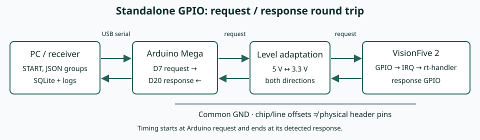
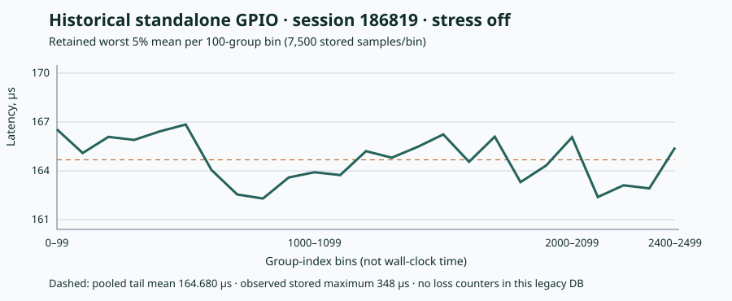

# Полный автономный эксперимент GPIO

[English](../../usage/standalone-gpio-walkthrough.md)

**Цель:** измерить полный цикл запроса и ответа GPIO VisionFive 2 с обработчиком
в пространстве пользователя и Arduino Mega 2560, сохранить сеанс SQLite,
проверить целостность и интерпретировать график. Стандартный запуск использует
RPM-пакеты ALT Linux. Для построения графиков и подготовки прошивки используются
исходники репозитория. В [протоколе проверки](../reference/validation.md) разделены
проверки, выполненные при подготовке документации, и ещё не выполненные проверки
на физическом стенде.

## 1. Разберитесь в измеряемом тракте



GPIO — линии ввода-вывода общего назначения. Задержка (latency) здесь — время
между переходом сигнала запроса Arduino и обнаруженным переходом сигнала ответа.
Она включает согласование электрических уровней, обработку GPIO/прерываний
целевой платы и работу `rt-handler` в пространстве пользователя. Это не задержка
пробуждения планировщиком, измеряемая cyclictest. PREEMPT_RT — конфигурация
вытеснения Linux для работы в реальном времени, а не гарантия соблюдения
предельного времени каждым трактом. Эталонному сценарию нужен потоковый IRQ GPIO,
к которому применимо планирование; перед сбором проверьте, что ваше ядро/обработчик
предоставляет такой поток.

Необходимые участники:

| Участник | Необходимая подготовка |
|---|---|
| Управляющий ПК | ALT Linux, `rt-tester-tools`, SSH, доступ к USB-порту Arduino, свободный порт приёмника 9101 |
| VisionFive 2 | ALT Linux, совместимый `rt-handler`, SSH, работающий `node_exporter`, потоковый IRQ GPIO |
| Arduino Mega 2560 | Прошивка этого репозитория, USB-кабель, подходящее согласование уровней |
| Подключение | Тракты запроса и ответа и общая GND в соответствии с установленным профилем обработчика |

Локальные или центральные Prometheus/Grafana — отдельный необязательный сценарий.
Начните с обычного сбора, чтобы не спутать неисправность панели с ошибкой подключения.

## 2. Установите инструменты и зафиксируйте окружение

На ПК, если пакет проекта доступен в настроенном репозитории:

```bash
apt-get install rt-tester-tools
rt-tester-run-gpio --help
```

При установке предоставленного локального RPM используйте
[справочник по установке](../reference/dependencies.md). Устанавливайте пакеты
с необходимыми административными правами; сбор на ПК выполняйте от пользователя,
которому принадлежат файлы эксперимента и предоставлен доступ к последовательному
устройству.

На целевой плате:

```bash
apt-get install rt-handler prometheus-node_exporter openssh-server
command -v rt-handler node_exporter chrt taskset
uname -r
rpm -q rt-handler prometheus-node_exporter
```

Настройте/запустите SSH и `node_exporter` через службы установленного пакета.
Проверьте фактическое имя службы в своей установке; исполняемый файл называется
`node_exporter`, а пакет — `prometheus-node_exporter`. Текущий сценарий требует
**работающий** `node_exporter` и задаёт его привязку к CPU даже при отключённом
запуске Prometheus/Grafana.

На ПК замените пример адреса своим и настройте доверие к ключу узла SSH:

```bash
export TARGET_HOST=192.0.2.10
ssh "root@$TARGET_HOST" 'uname -r; pgrep -a -x node_exporter; cat /proc/interrupts'
ssh -o BatchMode=yes "root@$TARGET_HOST" 'command -v rt-handler node_exporter chrt taskset'
export TARGET_KERNEL=$(ssh -o BatchMode=yes "root@$TARGET_HOST" uname -r)
```

`192.0.2.10` — адрес для документации: замените его доступным адресом целевой платы.
Здесь используется SSH от root, поскольку сценарий меняет планирование, привязку
к CPU и процессы платы. Другая учётная запись должна иметь эквивалентные настроенные
права. Сохраните с результатами ревизию платы, пакет/конфигурацию ядра, регулятор
частоты CPU, пакет обработчика, размещение CPU/IRQ и нагрузку.

Получите исходники для прошивки и последующего построения графиков:

```bash
mkdir -p "$HOME/src"
git clone https://altlinux.space/besogon1238/rt-tester.git "$HOME/src/rt-tester"
export RT_TESTER_SOURCE="$HOME/src/rt-tester"
git -C "$RT_TESTER_SOURCE" rev-parse HEAD
```

Если у вас уже есть рабочая копия, задайте `RT_TESTER_SOURCE` её абсолютным путём
и зафиксируйте ревизию. Используйте копию, соответствующую ревизии документации
и инструментов; старый RPM может ещё не содержать новые примеры профилей.
В таком случае копируйте профили из соответствующей рабочей копии, а не
из посторонней ревизии разработки.

## 3. Подготовьте прошивку, подключение и последовательный порт

Соберите/загрузите `src/arduino-meter/arduino-meter.ino` для Mega 2560 через Arduino
IDE или настроенный Arduino CLI с Arduino AVR core и ArduinoJson. Зафиксируйте
ревизию исходников и фактические версии инструментов/библиотек. Этот шаг не
автоматизирован RPM инструментов ПК; см. [подготовку Arduino](../hardware/arduino.md).

| Сигнал | Подключение |
|---|---|
| Запрос | Arduino D7 → согласование 5 В с 3,3 В → GPIO запроса целевой платы |
| Ответ | GPIO ответа целевой платы → подходящее обратное согласование → Arduino D20 |
| Опорный потенциал | Общая GND Arduino, преобразователя уровней и целевой платы |

Историческое соответствие обработчика `starfive` — смещения 60 и 61 устройства
`/dev/gpiochip0`. Проверьте **установленный** профиль `/etc/rt-handler/boards.d/`
и встроенное соответствие относительно ревизии платы и нумерации GPIO ядра.
Эти смещения не являются физическими контактами разъёма. До подключения запишите
соответствующие позиции контактов по распиновке платы; не выводите их из номеров
линий Linux. [Справочник GPIO целевой платы](../hardware/target-gpio.md) разграничивает
эти пространства номеров.

Mega использует логику 5 В, GPIO целевой платы — 3,3 В. D20 настроен как
`INPUT_PULLUP`; обратный преобразователь должен учитывать его подтяжку и входной
порог. Сохраняйте независимость запроса и ответа: прямое замыкание может давать
правдоподобные малые значения без измерения обработчика. До включения питания
проверьте подключение и уровни по документации платы и преобразователя.

Найдите последовательные порты ПК:

```bash
python3 -m serial.tools.list_ports -v
```

Предоставьте собирающему данные пользователю доступ через группу устройства
или правила udev, при необходимости переподключите устройство или повторно войдите
в систему и закройте монитор порта Arduino IDE перед запуском. Задайте
`arduino-port` в копии профиля, если автоматическое обнаружение неоднозначно.
Эталонный сценарий/приёмник использует 115200 бод; изменение только `arduino-baud`
не меняет скорость приёмника. Для этого примера используйте соответствующую
прошивку на 115200 бод.

## 4. Создайте собственный каталог эксперимента и профили

```bash
mkdir -p "$HOME/rt-experiments/visionfive2-gpio"
cd "$HOME/rt-experiments/visionfive2-gpio"
mkdir -p .rt-tester-example
cp /usr/share/rt-tester-tools/configs/stands/examples/visionfive2-gpio-*.conf .
```

Если используете соответствующие профили из исходников, замените последнюю команду:

```bash
cp "$RT_TESTER_SOURCE"/configs/stands/examples/visionfive2-gpio-*.conf .
```

Следующий шаг подставляет вашу целевую плату/ядро и превращает все пути ПК
из примеров в абсолютные. Выполните его один раз над свежими копиями из этого каталога:

```bash
python3 - <<'PY'
import os
from pathlib import Path
state = str((Path.cwd() / '.rt-tester-example').resolve())
for profile in Path.cwd().glob('visionfive2-gpio-*.conf'):
    text = profile.read_text()
    text = text.replace('TARGET_HOST', os.environ['TARGET_HOST'])
    text = text.replace('TARGET_KERNEL', os.environ['TARGET_KERNEL'])
    text = text.replace('.rt-tester-example', state)
    profile.write_text(text)
PY
```

Изучите копии до запуска. `board = starfive` целевой платы выбирает соответствие
VisionFive 2 обработчика; пользовательская метка — `visionfive2`. Проверьте
`irq-name`, CPU, приоритеты, выбор порта, ядро и пути. Пример предполагает CPU 1
для обработчика/IRQ и CPU 0,3 для служебных задач. Изменение этих назначений
изменяет эксперимент. Центральная передача настраивается отдельно в разделе
[централизованного мониторинга](../observability/central.md).

Для установленного `0.4.2` абсолютные пути важны: сценарий запускает приёмник из собственного каталога
исходников, поэтому относительный путь базы **не гарантированно** относится
к вашему каталогу эксперимента. INI-файлы не выполняют произвольную подстановку
переменных оболочки; не записывайте буквальные `$PWD` или `$HOME` в путях сценария.

Эталонные параметры: 1500 запросов на группу, минимальный интервал 1000 мкс,
предельное время ответа 10000 мкс, 100 групп, нагрузка выключена. Группы без потерь
сохраняют 75 наихудших отсчётов ответа. Номинально полный запуск длится 150 секунд
плюс подготовка, накладные расходы последовательной передачи/обработки и ожидание
ответов. Пробная проверка не характеризует поведение системы.

## 5. Выполните и проверьте пробный запуск из трёх групп

```bash
SMOKE_ID=$(date +%s)
rt-tester-run-gpio --config ./visionfive2-gpio-basic.conf \
  --session-id "$SMOKE_ID" --groups 3 \
  --db "$PWD/.rt-tester-example/smoke.db" \
  --no-prometheus --no-grafana
```

Для базового профиля обязательны оба флага отключения. Сценарий всё равно запускает
конечную точку метрик приёмника и требует `node_exporter` целевой платы.
Используйте стенд монопольно: текущий сценарий очищает старые обработчики,
локальные приёмники и процессы нагрузки платы; во время запуска он управляет
жизненным циклом целевой платы.

Ожидаемый вывод содержит `Stand`, `Session ID`, `Execution mode: userspace`,
`Arduino serial preflight OK`, ход обработки групп, `SQLite summary`
и `GPIO measurement completed successfully`. Это список признаков ожидаемого
вывода, а не протокол нового выполненного аппаратного запуска.

Для пробного запуска без потерь сводка должна показывать группы `(3, 0, 2)`,
225 сохранённых задержек и целостность `(4500, 4500, 4500, 0, 0)`: ожидаемые
запросы, отправленные запросы, ответы, тайм-ауты, проблемные группы. Значения
задержек зависят от стенда. Код выхода 2 означает сводку аномалий сценария;
изучите сохранённую БД и журнал платы, а не считайте это успешным экспериментом
без аномалий.

`--dry-run` записывает сгенерированные конфигурационные файлы и может проверять
состояние HTTP; это не предварительная проверка только для чтения.
`--prepare-only` также изменяет состояние целевой платы.

## 6. Соберите эталонный сеанс

```bash
export SESSION_ID=$(date +%s)
rt-tester-run-gpio --config ./visionfive2-gpio-basic.conf \
  --session-id "$SESSION_ID" --groups 100 \
  --db "$PWD/.rt-tester-example/gpio.db" \
  --no-prometheus --no-grafana
```

Для каждого запуска используйте новый идентификатор сеанса. Сохраните его вместе
с изменённым профилем, ревизией прошивки, версиями, подключением/уровнями,
частотной политикой и условиями измерения. Целевые показатели без потерь:
100 групп, 150000 запросов/ответов, ноль тайм-аутов и 7500 сохранённых строк
задержек. Номинальная длительность группы не гарантирует реальную длительность
по часам. После сбора сценарий останавливает обработчик платы; управляемый
мониторинг в последующих сценариях сохраняется до явной остановки.

## 7. Проверьте целостность основного артефакта

При остановленном приёмнике выполните из каталога эксперимента:

```bash
python3 - <<'PY'
import os, sqlite3
from pathlib import Path
sid = int(os.environ['SESSION_ID'])
uri = (Path('.rt-tester-example/gpio.db').resolve().as_uri() + '?mode=ro')
with sqlite3.connect(uri, uri=True) as conn:
    print('SQLite:', conn.execute('PRAGMA integrity_check').fetchone()[0])
    groups = conn.execute('SELECT count(*), min(group_index), max(group_index), '
        'count(DISTINCT group_index) FROM groups WHERE session_id=?', (sid,)).fetchone()
    counts = conn.execute('SELECT sum(requests_sent), sum(responses_received), '
        'sum(timeout_count) FROM groups WHERE session_id=?', (sid,)).fetchone()
    bad = conn.execute('SELECT count(*) FROM groups WHERE session_id=? AND '
        '(requests_sent != measurements_per_group OR responses_received != requests_sent '
        'OR timeout_count != 0)', (sid,)).fetchone()[0]
    tail = conn.execute('SELECT count(*) FROM latencies l JOIN groups g '
        'ON g.id=l.group_id WHERE g.session_id=?', (sid,)).fetchone()[0]
    events = conn.execute('SELECT event_type,count(*) FROM events WHERE session_id=? '
        'GROUP BY event_type', (sid,)).fetchall()
    print('groups / counters / tail / events:', groups, counts, tail, events)
    assert groups == (100, 0, 99, 100)
    assert counts == (150000, 150000, 0) and bad == 0
    assert tail == 7500
    assert not any(kind in ('fall', 'recovery') for kind, count in events)
print('Reference no-loss checks passed')
PY
```

Изучите все дополнительные события и сохранённую диагностику. Эта SQL-проверка
дополняет сводку сценария: проверяющий инструмент построения графиков сейчас
не проверяет счётчики ответов, а напечатанные им сообщения об ошибках не гарантируют
ненулевой код выхода процесса. Для автономного режима импортированные строки
трассировки не ожидаются; при отсутствии доступного Prometheus строки SoC
также не ожидаются.

Для архива закройте процессы сбора и используйте механизм резервного копирования
SQLite, чтобы получить согласованный снимок; копирование только `.db`, пока
у записывающего процесса есть данные в WAL, может потерять зафиксированные
результаты. Сохраните оригинал и заметки эксперимента.

## 8. Постройте график сохранённого хвоста

На ПК установите доступные пакеты ALT для построения графиков:

```bash
apt-get install python3-module-pandas python3-module-numpy python3-module-matplotlib
python3 "$RT_TESTER_SOURCE/src/pc-receiver/plot_statistics.py" \
  "$PWD/.rt-tester-example/gpio.db" --session "$SESSION_ID" \
  --top 75 --limit 250 --output "$PWD/.rt-tester-example/latency.png" latency
```

Эти инструменты доступны только в исходниках. Линия «Average Latency» — среднее
выбранного сохранённого хвоста **для каждой группы**, а не среднее всех 1500 ответов.
Затенённый диапазон простирается до наблюдаемого максимума этой группы.
Порог — выбор анализа, а не предельное время ответа; 250 мкс здесь приведены
для иллюстрации. До сравнений прочтите
[раздел статистики](../reference/measurement-statistics.md).

## 9. Разберите реальный исторический результат



Этот включённый в пакет SVG получен из отслеживаемой базы
`tests/old_databases/28032026.db`, сеанс `186819`. Историческая установка
и исходный график зафиксированы в `tests/visionfive_tests.md`
и `tests/results_starfive/186819_visionfive_6.18_300_75_stress_off.png`
в рабочей копии. Это был прямой эксперимент GPIO VisionFive 2 с обработчиком
в пространстве пользователя, а не запуск с супервизором.

| Сохранённое свойство | Историческое значение |
|---|---:|
| Метки ядра / нагрузки | `6.18` / нагрузка выключена |
| Группы / запросы на группу | 2500 / 1500 |
| Минимальный интервал запросов | 300 мкс |
| Сохранённые значения на группу / всего | 75 / 187500 |
| Среднее объединённого сохранённого хвоста | 164.679701 мкс |
| Наблюдаемый максимум сохранённой задержки | 348 мкс |
| Средний записанный джиттер всей группы | 25.769485 мкс |
| Строки метрик SoC | 2337; покрытие неполное |

Каждая точка SVG усредняет 7500 отсчётов хвоста из 100 последовательных групп.
Пунктирная линия — среднее объединённого хвоста. Ось X показывает блоки групп,
а не время по часам; масштаб оси Y увеличен. Группировка сглаживает отдельные
выбросы — максимум указан отдельно. Полный набор данных доступен в рабочей копии,
а не внутри RPM.

Воспроизведите исторический график задержек на **копии для анализа** из каталога
сохранённого эксперимента:

```bash
python3 - <<'PY'
import os, sqlite3
from pathlib import Path
source = Path(os.environ['RT_TESTER_SOURCE']) / 'tests/old_databases/28032026.db'
destination = Path('.rt-tester-example/historical-analysis.db')
assert not destination.exists(), 'Choose a fresh analysis-copy filename'
with sqlite3.connect(source.resolve().as_uri() + '?mode=ro&immutable=1', uri=True) as src:
    with sqlite3.connect(destination) as dst:
        src.backup(dst)
        dst.execute("ALTER TABLE groups ADD COLUMN target_payload TEXT DEFAULT 'unknown'")
PY
python3 "$RT_TESTER_SOURCE/src/pc-receiver/plot_statistics.py" \
  "$PWD/.rt-tester-example/historical-analysis.db" --session 186819 \
  --top 75 --limit 250 --output "$PWD/.rt-tester-example/historical-latency.png" latency
```

Добавленное поле `target_payload` — только метаданные совместимости, необходимые
текущему инструменту построения графиков, и его значение явно неизвестно;
исходная БД остаётся неизменной. Не применяйте текущую универсальную проверку/отчёт
к этой старой схеме так, будто она содержит современные счётчики и таблицы
трассировки. `immutable=1` уместен здесь только потому, что исторический источник
под контролем версий — закрытый снимок, а не действующая БД эксперимента.

**Подтверждаемая интерпретация:** среднее сохранённых наихудших 5% составляло
около 164,68 мкс, а наблюдаемый сохранённый максимум — 348 мкс в том историческом
запуске. **Неподтверждаемая интерпретация:** каждый запрос уложился в предельное
время, p99 всех ответов составил 164,68 мкс или PREEMPT_RT вызвал улучшение.
В этой старой БД нет счётчиков ответов/тайм-аутов и точных сведений о версиях ядра,
обработчика, прошивки, настройках привязки к CPU и регулятора частоты. Её интервал
300 мкс отличается от 1000 мкс нового примера.

## 10. Добавьте мониторинг или спланируйте следующий эксперимент

Продолжите с [локальными Prometheus/Grafana](../observability/local.md), затем
при необходимости перейдите к [центральной доставке метрик](../observability/central.md).
Сохраняйте SQLite независимо от оперативных панелей. Для более длительных серий,
сравнений без нагрузки/с нагрузкой или сравнений ядер используйте
[методику GPIO](../methodology/gpio-measurements.md) и фиксируйте все контролируемые
условия; максимум пробного запуска не является верхней границей худшего случая.

| Симптом | Что проверить сначала |
|---|---|
| Arduino не обнаружен / порт не открывается | USB-устройство, права, выбранный порт, другое приложение последовательного порта |
| Отсутствует поток IRQ / ошибка привязки | Установленное соответствие линий обработчика, потоковые IRQ ядра, `irq-name` и CPU |
| Тайм-ауты или неправдоподобно малая задержка | Подключение, преобразователь уровней, общая GND, реальный ответ обработчика вместо прямого замыкания |
| БД находится не там, где ожидалось | Абсолютный путь `--db`/профиля и рабочий каталог приёмника |
| Пустая панель | Проверьте приёмник, локальный опрос метрик, источник данных, сеанс и диапазон времени до изменения измерения |
